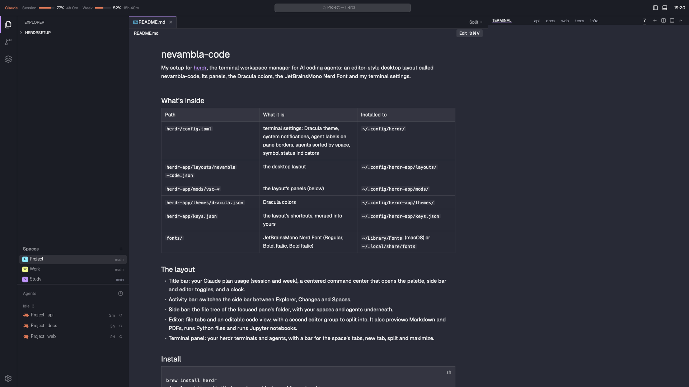

# nevambla-code

My setup for [herdr](https://herdr.dev), the terminal workspace manager for AI coding agents: an editor-style desktop layout called **nevambla-code**, its panels, the Dracula colors, the JetBrainsMono Nerd Font and my terminal settings.



## What's inside

| Path | What it is | Installed to |
| --- | --- | --- |
| `herdr/config.toml` | terminal settings: Dracula theme, system notifications, agent labels on pane borders, agents sorted by space, symbol status indicators | `~/.config/herdr/` |
| `herdr-app/layouts/nevambla-code.json` | the desktop layout | `~/.config/herdr-app/layouts/` |
| `herdr-app/mods/vsc-*` | the layout's panels (below) | `~/.config/herdr-app/mods/` |
| `herdr-app/themes/dracula.json` | Dracula colors | `~/.config/herdr-app/themes/` |
| `herdr-app/keys.json` | the layout's shortcuts, merged into yours | `~/.config/herdr-app/keys.json` |
| `fonts/` | JetBrainsMono Nerd Font (Regular, Bold, Italic, Bold Italic) | `~/Library/Fonts` (macOS) or `~/.local/share/fonts` |

## The layout

- **Title bar:** your Claude plan usage (session and week), a centered command center that opens the palette, side bar and editor toggles, and a clock.
- **Activity bar:** switches the side bar between Explorer, Changes and Spaces.
- **Side bar:** the file tree of the focused pane's folder, with your spaces and agents underneath.
- **Editor:** file tabs and an editable code view, with a second editor group to split into. It also previews Markdown and PDFs, runs Python files and runs Jupyter notebooks.
- **Terminal panel:** your herdr terminals and agents, with a bar for the space's tabs, new tab, split and maximize.

## Install

```sh
brew install herdr
git clone https://github.com/nevambla/nevambla-code.git
cd nevambla-code
./install.sh
```

Open the herdr desktop app once before running it, so `~/.config/herdr-app` exists. The installer:

- backs up anything it replaces to `~/.config/nevambla-code-backups/<time>/`
- merges the shortcuts and never replaces a key you already use (it warns instead)
- switches an open herdr window to the layout; otherwise pick **nevambla-code** in Settings → Look → Layout, or cycle with `ctrl-shift-l`

### Optional tools

- PDF preview: `brew install poppler`
- Notebooks: `pip install jupyter_client ipykernel` (the editor uses the project's nearest `.venv`, else `python3`)

## What the panels do on your machine

As herdr asks for shared layouts:

- **Network:** the title bar's usage meter (`vsc-titlebar/usage.sh`) reads your Claude Code login from the macOS Keychain and asks `api.anthropic.com` for your plan usage, the same data as Claude Code's `/usage`. The token stays inside that script. It is macOS only; elsewhere it shows no data.
- **Programs:** the editor runs `python3` (notebooks, through `vsc-editor/kernel.py`), `pdftoppm` / `pdfinfo` (PDFs) and `open` (Open in Preview).
- **Files:** the Explorer and editor read and save files in the folders your panes are in. PDF pages and notebook state are cached in `~/.config/herdr-app/data/vsc-editor/`.

## Claude accounts in the title bar

By default the meter shows your default `claude` login. To show several accounts, add `props` to the title bar block in `~/.config/herdr-app/layouts/nevambla-code.json`:

```json
"content": {
  "mod": "vsc-titlebar",
  "props": {
    "accounts": [
      { "name": "Personal" },
      { "name": "Work", "config_dir": "~/.claude-work", "command": "claude-work" }
    ]
  }
}
```

- `name`: shown in the dropdown.
- `config_dir`: the `CLAUDE_CONFIG_DIR` that account's Claude Code uses. Leave it out for the default login.
- `command`: what you type to start it, shown as a hint. Defaults to `claude`, or the config folder's name.
- `id` (optional): key for its cached usage. Defaults to the name.

The first account is the default. Hover or click **Claude** in the title bar to see them all and pick the one to show.

## Shortcuts

| Keys | Action |
| --- | --- |
| ⌘B | show or hide the side bar |
| ⌘J | show or hide the terminal panel |
| ⌘⌥J | move the terminal panel between the bottom and the right |
| ⌘⇧V | switch a Markdown file between editing and preview |
| ⌘⌥R | run the open Python file |
| ⌘S / ⌘W | save / close the file (in the editor) |
| ⇧↩ or ⌘↩ | run the notebook cell (in the editor) |

## Agent integrations

Integrations are not part of these files. Install the ones you use, for example `herdr integration install claude`, and see them all with `herdr integration status`.

## Uninstall

Delete `~/.config/herdr-app/layouts/nevambla-code.json` and the `~/.config/herdr-app/mods/vsc-*` folders, then switch layouts with `ctrl-shift-l`. Your backups are in `~/.config/nevambla-code-backups/`.

## License

The font is JetBrains Mono patched by [Nerd Fonts](https://www.nerdfonts.com) (v3.4.0), under the SIL Open Font License 1.1 (`fonts/OFL.txt`).
